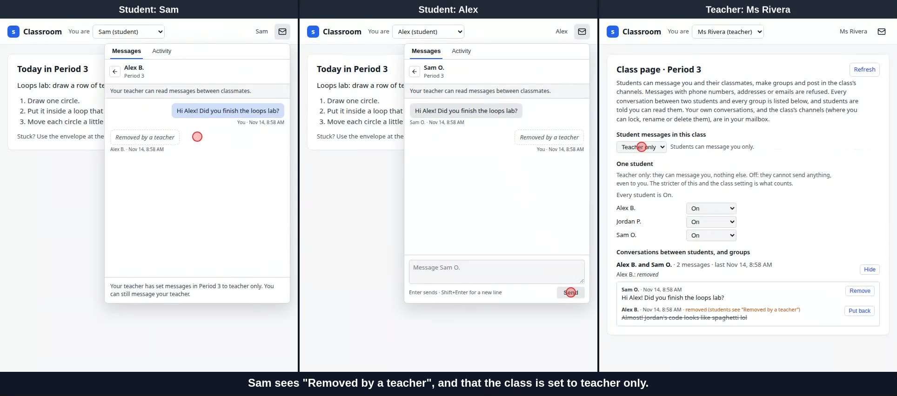
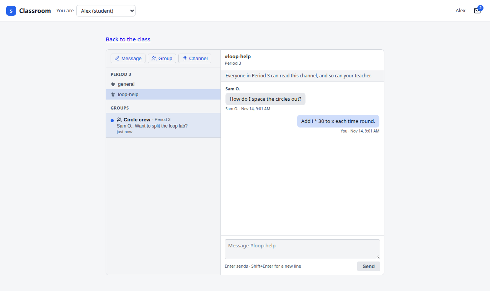

# soSHial

Small, in-app messaging for classrooms. Students message their teacher, teachers message students,
classmates message each other, in group chats and in class channels like Discord, with the teacher able to
read, remove and turn it down or off. It runs inside
your own app on Cloudflare D1 (or anything D1-shaped), with React components for the page. There is no
chat server, no container and no outside service.

[](docs/demo.mp4)

*Watch the 38-second demo: [docs/demo.mp4](docs/demo.mp4). Try it yourself with `npm run demo` ([below](#try-it)).*

- **Teacher and student, both ways.** A teacher writes to a student; the student replies.
- **Classmate to classmate.** Two students in the same class can message each other.
- **Group chats.** Anyone can start a group of up to 8 people from one class, name it, add people and leave.
- **Class channels.** Every class has #general; anyone can add a channel. Teachers can lock one so only
  teachers post (announcements), rename it or delete it.
- **Teachers can see.** A class's teachers read every conversation between two of its students and every
  group, and students are told so above each one (*"Your teacher can read this group."*). Channels are
  read by the whole class.
- **Three levels, per class and per student.** On; Teacher only (they can only message a teacher);
  Off (they cannot send anything, but can still read). The stricter of the class's and the student's wins.
  Teachers are never limited.
- **Remove a message.** Anywhere between students: they see *"Removed by a teacher"*; the teacher still
  sees the words and can put it back.
- **A personal-details check.** Every message is checked for phone numbers, street addresses, emails and
  similar on the server. A message that has one is refused with a plain reason.
- **Names, not emails.** People appear as the name your app gives them (first name + last initial is a
  good choice). A page never receives a user id or an email: a person is a random public key.
- **Limits.** 1,000 characters a message; 10 a minute and 200 a day per student; 2,000 per conversation.
  All adjustable.
- **A dropdown and a full page.** `<MailboxButton>` shows one count and a dropdown with a Messages tab
  beside your own notification tabs (and a button to the full page); `<MessagesPage>` is the same
  conversations as a two-column page, Discord-style.

It polls (every 30 s for the count, every 10 s in an open conversation) rather than holding a socket open,
so it needs nothing but your existing Functions and database.

## Try it

```bash
npm install
npm run demo      # http://localhost:4400
```

One process with an in-memory database and a made-up class, Period 3: Ms Rivera (teacher) and Sam,
Alex and Jordan (students). Use **You are** at the top to switch person, or open two browsers (a normal and
a private window) to be two people at once.

1. As **Sam**, press the envelope, then **New message**, pick **Alex B.** and send something.
2. As **Alex**, the envelope shows a count. Open the conversation and reply.
3. As **Sam**, try sending a phone number (`555-201-3344`): it is refused in plain words.
4. As **Ms Rivera**, the class page lists the conversation. **Read** it, **Remove** a message, and set
   **Student messages in this class** to **Teacher only**.
5. Back as **Sam**, the message reads *Removed by a teacher* and the conversation says the class is set to
   teacher only.
6. Press **Group** or **Channel** in the envelope to make one, and the arrows button (or `/?view=messages`)
   for the full page:



The demo signs you in as whoever the picker names. That is for the demo only: a real app takes the user id
from its own sign-in. `npm run demo:record` re-records the video above (see `examples/demo/record.mjs`).

## How it fits together

```
your page                       your Pages Function                     your D1
<MailboxButton>  ── fetch ──▶   /api/soshial/[[path]].ts                soshial_* tables
<ClassMessages>                   createSoshial({ db, directory })  ──▶ (migrations/0001_soshial.sql)
                                    └─ directory: YOUR classes,
                                       who teaches, who is enrolled
```

soSHial never reads your tables. You give it a **`ClassDirectory`**: five small functions that answer
"what is this class", "what is this person's role in it", "who is in it", "which classes is this person
in" and "what is this person called". That is the only part you write.

## Set up

### 1. Add the tables

Apply `migrations/0001_soshial.sql`, then `migrations/0002_groups_channels.sql`, to your D1 database (copy
them into your migrations folder, or run them with `wrangler d1 execute`). Every table starts with `soshial_`.

**Upgrading from 0.1.0:** apply `0002_groups_channels.sql`. Nothing else changes for you: 0.1.0's class
switch reads as level 1 (Teacher only) and every paused student as level 1, and the old actions
(`classmates-off`/`on`, `mute`/`unmute`) still work. The list now starts with each class's channels, and
`ClassOverview` gained `level`, each student's `level`, and each thread's `kind` and `title`.

### 2. Write your directory

```ts
import type { ClassDirectory } from 'soshial';

export function myDirectory(db: D1Database): ClassDirectory {
  return {
    async classInfo(classId) { /* { id, name, archived } or null */ },
    async roleIn(classId, userId) { /* 'teacher' | 'student' | null, as of NOW */ },
    async people(classId) { /* [{ id, name, role }] for everyone in the class now */ },
    async classesOf(userId) { /* ids of the live classes this person is in */ },
    async nameOf(userId) { /* the name to show */ },
  };
}
```

`examples/sql-directory.ts` is a complete one over three plain tables (`examples/schema.sql`).

### 3. Add one route

A catch-all Pages Function at `functions/api/soshial/[[path]].ts`:

```ts
import { createSoshial } from 'soshial';
import { myDirectory } from '../../../lib/my-directory';
import { getSession } from '../../../lib/my-auth';

export const onRequest = async ({ request, env }) => {
  const session = await getSession(request, env);          // { userId } or null; from YOUR sign-in
  const soshial = createSoshial({ db: env.DB, directory: myDirectory(env.DB) });
  return (await soshial.handle(request, session)) ?? new Response('Not found', { status: 404 });
};
```

The user id must come from your own session, never from the request. `handle` answers 401 when the session
is null. Pass `{ userId, admin: true }` for someone who may use any class's teacher panel.

When your app deletes a class, call `soshial.deleteClass(classId)`.

### 4. Put the components on your pages

```tsx
import { MailboxButton, ClassMessages, createClient } from 'soshial/react';

const client = createClient('/api/soshial');

// In your header:
<MailboxButton client={client} fullPageHref="/messages" />

// On /messages (optional): the same conversations as a full page. `footer` goes under the list.
<MessagesPage client={client} footer={<a href="/help">Help</a>} />

// On your class page, for its teachers:
<ClassMessages client={client} classId={classId} onToast={(msg, kind) => showToast(msg, kind)} />
```

`<Mailbox>` on its own is the same mailbox without the envelope, for a drawer. The pieces it is made of
(`ConversationList`, `ThreadPane`, `NewMessage`, `NewGroup`, `NewChannel`) are exported too, inside a
`<SoshialProvider client={client}>`, if you want your own layout.

## Your notifications in the same envelope

soSHial does not keep notifications: your app already knows what is news (a comment, a grade, a due date).
Hand the envelope a tab for each kind, with its unread count, and the envelope adds the counts up:

```tsx
<MailboxButton
  client={client}
  tabs={[{
    id: 'activity',
    label: 'Activity',
    count: unreadActivity,
    onOpen: () => refreshActivity(),
    render: () => <ActivityList items={activity} />,
  }]}
/>
```

It opens on Messages unless only one of your tabs has news.

## Theme

Every colour is a CSS variable with a dark default. Set any of them on an ancestor:

```css
.light {
  --soshial-bg: #ffffff;
  --soshial-deep: #f3f4f6;
  --soshial-deep2: #e5e7eb;
  --soshial-fg: #111827;
  --soshial-meta: #374151;
  --soshial-dim: #4b5563;
  --soshial-line: #d1d5db;
  --soshial-accent: #2563eb;
  --soshial-on-accent: #ffffff;
  --soshial-link: #1d4ed8;
  --soshial-teacher: #7c3aed;
  --soshial-danger: #b91c1c;
  --soshial-warn: #b45309;
}
```

## Options

```ts
createSoshial({
  db, directory,
  base: '/api/soshial',                       // where the routes live
  limits: { messageMax: 500, perMinute: 5 },  // any of messageMax, messageLines, perMinute, perDay, perThread
  findPII: (text) => myCheck(text),           // replace the personal-details check; return a label or null
});
```

If you change `messageMax`, pass the same number to the components as `messageMax` so the page agrees.

## The routes

All JSON, under `base`:

| | |
| --- | --- |
| `GET /messages` | each class's channels, then the caller's conversations and groups, newest first, and `unread` |
| `GET /messages?count=1` | only `unread` (two-person conversations and groups; a channel with news is shown bold instead) |
| `GET /messages?people=1` | whom the caller may write to, per class |
| `POST /messages` `{ classId, to, body }` | send to a person (`to` is their public key) |
| `POST /messages` `{ classId, create: 'group', people, title? }` | a group of 2-8 people of the class |
| `POST /messages` `{ classId, create: 'channel', name }` | a channel for the whole class |
| `GET /messages/:id` | one conversation, group or channel; marks it read |
| `POST /messages/:id` `{ body }` | send in it |
| `POST /messages/:id` `{ action, ... }` | `rename` `{ title }`, `add` `{ people }`, `leave`, `lock`, `unlock`, `delete`, `remove` / `restore` `{ messageId }` |
| `GET /classes/:id/messages` | teacher panel: the levels, the students, conversations between students and groups |
| `GET /classes/:id/messages?thread=:id` | one of them, removed messages included |
| `POST /classes/:id/messages` | `{ action: 'class-level', level }`, `{ action: 'student-level', student, level }` (0 On, 1 Teacher only, 2 Off), `{ action: 'remove' \| 'restore', messageId }` |

## What it does not do

- **Instant delivery.** It polls. For live delivery, push a "something changed" ping over your own
  WebSocket and call `client.refreshCount()`.
- **Name-based safety checks.** The check finds structured details (numbers, addresses, emails), not names
  or bullying. That is what the teacher's view and Remove are for.
- **Attachments, reactions, typing indicators.**

## Develop

```bash
npm install
npm test          # the server against a real SQLite, 102 checks
npm run typecheck
```

Node 22.5 or newer (the tests use `node:sqlite`).

## Licence

MIT. See [LICENSE](LICENSE).
